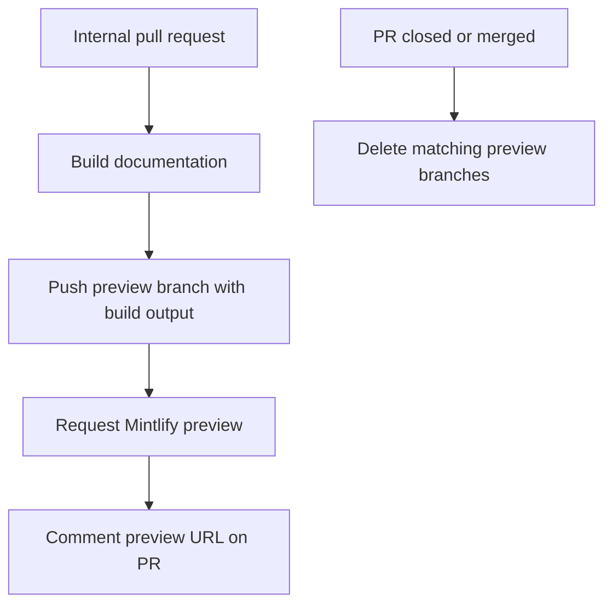

# Repository Wiki Quickstart

This repository builds the Mintlify site at [docs.langchain.com](https://docs.langchain.com), not the generated SDK reference at [reference.langchain.com](https://reference.langchain.com/python/). Start with a durable input—authored source, site configuration, metadata, or generator code—not a rendered or generated result. `build/` is regenerated from `src/` and is never an authoring surface. Report a problem with the external reference site through the [reference documentation issue template](https://github.com/langchain-ai/docs/issues/new?template=04-reference-docs.yml).

## First local change

Read `AGENTS.md` first. It is the repository-wide authoring guide; task-specific procedures live in `.agents/skills/`. Run `make skills` to link them into `.claude/skills/` for Claude Code. In particular, use the relevant skill for page restructuring, page lifecycle changes, reviews, code samples, or integrations. A change to a script, workflow, Make target, CI check, scheduled job, or skill also requires the `docs-tooling-notion` procedure.

The project requires Python 3.13 or later. From a checkout, install dependencies and start the local preview:

```bash
git clone https://github.com/langchain-ai/docs.git
cd docs
make install
make dev
```

`make install` synchronizes all Python dependency groups, installs project npm dependencies and the global Mintlify CLI, and links skills. `make dev` makes an initial build, watches `src/`, and serves the generated `build/` tree at <http://localhost:3000>. It stops when that initial build fails. Use `uv run pipeline dev --skip-build` only when a suitable generated tree already exists.

## Route the change by owner

Source ownership, emitted route family, Mintlify navigation, and deployment-generated references are independent concerns. In particular, do not infer the source directory from a reader-facing menu label.

| If the task is to... | Change the durable owner | Then |
| --- | --- | --- |
| Revise maintained prose, an image, or a reusable fragment | The applicable `src/` page, asset, or `src/snippets/` input | Keep frontmatter descriptions free of Markdown, use Tabler icons, and test included examples. |
| Add, move, rename, retire, or place a page | Its source plus `src/docs.json` | Update navigation and redirects as appropriate. See [Adding and Maintaining Documentation Pages](/openwiki/operations/adding-pages.md). |
| Identify a source subtree or its output URLs | The route-owning source family | See [Source Directory Map](/openwiki/architecture/source-map.md) and [Versioned Documentation and Routes](/openwiki/concepts/versioning.md). |
| Change menu order, labels, site settings, redirects, or OpenAPI declarations | `src/docs.json` | Navigation is explicit site configuration, not route generation. |
| Change preprocessing, build behavior, or output routing | `pipeline/` and focused tests | See [Testing Overview](/openwiki/testing/test-overview.md). |
| Change a runnable example or displayed extracted snippet | `src/code-samples/` | Test the source, then regenerate its derivatives. See [Code Sample Lifecycle](/openwiki/workflows/code-sample-lifecycle.md). |
| Change an integration listing | Hosted integration frontmatter or `scripts/data/integration_external_docs.yaml` | Validate URLs and regenerate. See [Integration Listing Automation](/openwiki/workflows/integration-listing-automation.md). |
| Repair SDK API reference at `reference.langchain.com` | The external reference-build owner | File the reference-documentation issue; this repository has no reference build output. |

`src/docs.json` is the Mintlify navigation and site-configuration source of truth; add pages there. Its two product menus organize the agent-development lifecycle and product/setup content, but are not a source map: Build mixes OSS and LangSmith content, Fleet appears as **No-code agents**, and Deep Agents Code is in product/setup.

The builder clears `build/`, emits Python and JavaScript OSS variants, emits OpenWiki and Deep Agents Code without a language split, emits ordinary LangSmith content unversioned, emits language-prefixed Managed Deep Agents variants, and copies shared files. Inspect the emitted family after a change, but never treat it as authored input. For the full ownership and route rules, use [Source Directory Map](/openwiki/architecture/source-map.md) and [Versioned Documentation and Routes](/openwiki/concepts/versioning.md).

For a shared OSS `@[ref]` cross-reference, an unfenced reference must resolve in both Python and JavaScript scopes. Put a language-only API name in a `:::python` or `:::js` block and run `make check-cross-refs`.

## Regenerate derivatives, do not patch them

- **Provider overview:** `src/oss/python/integrations/providers/overview.mdx` is generated by `pipeline/tools/partner_pkg_table.py` from `packages.yml`. Update the generator or metadata, run `uv run python pipeline/tools/partner_pkg_table.py`, and commit the result; CI rejects drift.
- **Runnable samples and snippets:** `src/code-samples/` is executable source. `make code-snippets` extracts marked content to `src/code-samples-generated/` and generates imported MDX in `src/snippets/code-samples/`. Both destinations are derivatives, not authoring surfaces. Test a changed sample with `make test-code-samples FILES="src/code-samples/..."` before regeneration.
- **Integration listings:** listing data combines hosted-guide `integration:` frontmatter with `scripts/data/integration_external_docs.yaml`. Check permitted documentation URLs before regeneration with `uv run python scripts/refresh_integration_downloads.py --check-docs-urls`.
- **OpenAPI endpoint pages:** Mintlify generates configured endpoint pages during deployment, not in local `build/`. Change the specification or its `src/docs.json` declaration. The committed LangSmith platform spec is refreshed by automation and is not a hand-edited surface; see [Adding and Maintaining Documentation Pages](/openwiki/operations/adding-pages.md).

## Choose the smallest relevant validation

| Changed boundary | Start with | What it covers |
| --- | --- | --- |
| Pipeline, builder, preprocessor, or generator | `make test TEST_FILE=tests/unit_tests/path_or_test.py` | Pytest with network sockets disabled except Unix sockets. |
| Source `@[ref]` or conditional content | `make check-cross-refs` | Every relevant source scope, including both scopes for shared unfenced OSS content. |
| Page prose | `make lint_prose FILES="src/path/to/page.mdx"` | The pinned Vale prose checks. |
| Python tooling or spelling | `make lint` | Formatting, linting, types, and source spelling. |
| Route, redirect, link, or anchor | `make broken-links-with-anchors` | Builds first, then validates links, anchors, and redirect destinations. |
| Agent Server OpenAPI | `make check-openapi` | Builds first and validates the configured Agent Server spec. |
| Runnable example and rendered snippet | `make test-code-samples FILES="src/code-samples/..."` and `make code-snippets` | Executes selected source samples and refreshes derived snippet artifacts. |

Core CI runs on pushes to `main`, pull requests, and manual dispatch. It runs tests, lint, built link and OpenAPI validation, strict cross-reference and external-integration URL checks, and provider-overview drift detection. The code-sample workflow is manual, scheduled monthly, and runs for relevant pull requests; it skips fork pull requests because samples can require repository secrets. For gates, trust boundaries, and triage, see [GitHub Actions and CI/CD](/openwiki/integrations/github-actions.md).

## Preview lifecycle

For an internal pull request, the preview workflow builds the documentation, creates a collision-resistant `preview-...` branch containing forced-added `build/` artifacts, requests a Mintlify preview with repository secrets, and comments on the PR. It does not create preview branches for fork pull requests, and a closed or merged PR triggers cleanup of matching preview branches. The preview branch is deployment material only: do not merge it or use it as an authoring source.



This shows the internal-PR preview branch lifecycle; fork pull requests do not enter the branch-creation path.

## Finish safely

1. Confirm that the edit targets authored input, configuration, metadata, or generator policy—not `build/`, a rendered page, or a deployment-generated surface.
2. Identify source ownership and emitted route variants before editing navigation. Update `src/docs.json` and redirects explicitly when needed.
3. Regenerate affected derivatives, then inspect every language or unversioned route family the source owns.
4. Run the smallest source check first; add build, link, OpenAPI, or deployment-facing validation when the change crosses that boundary.

## Task-routing map

- [Source Directory Map](/openwiki/architecture/source-map.md): source ownership, route families, navigation, redirects, and generated references.
- [Versioned Documentation and Routes](/openwiki/concepts/versioning.md): shared, language-owned, unversioned, and Managed Deep Agents content.
- [Adding and Maintaining Documentation Pages](/openwiki/operations/adding-pages.md): page creation, moves, retirement, navigation, redirects, and deployment surfaces.
- [Testing Overview](/openwiki/testing/test-overview.md): focused, rendered, credentialed, remote, and hosted validation.
- [GitHub Actions and CI/CD](/openwiki/integrations/github-actions.md): CI gates, preview lifecycle, and trust boundaries.
- [Code Sample Lifecycle](/openwiki/workflows/code-sample-lifecycle.md): executable examples, snippet generation, trace refresh, and sample automation.
- [Integration Listing Automation](/openwiki/workflows/integration-listing-automation.md): integration metadata, URL validation, and listing refresh.
- [LangSmith Changelog Publication](/openwiki/workflows/changelog-publication.md): reviewed changelog assembly and publication ownership.
