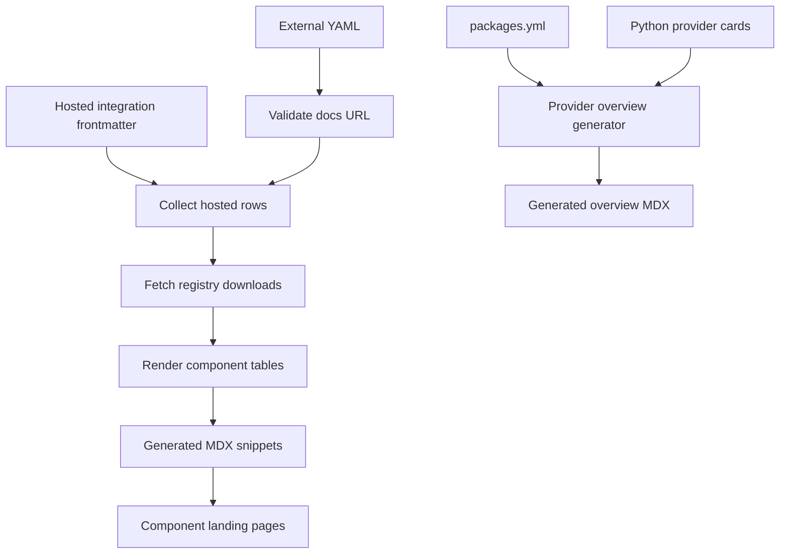
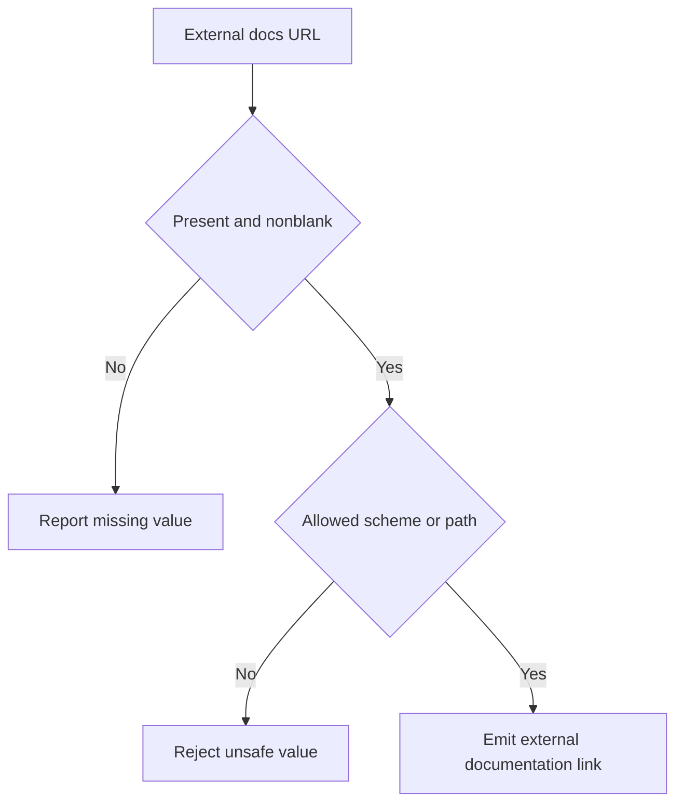
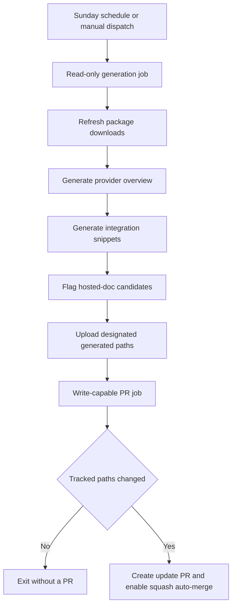

# Integration Listing Automation

Integration discovery has two distinct derived documentation surfaces: component download tables and the Python provider overview. Change metadata, an authored provider card, or generator code; then regenerate and review the affected derived files. Do **not** hand-edit generated integration snippets under `src/snippets/oss/` or `src/oss/python/integrations/providers/overview.mdx`.

## Ownership and listing boundary

A package with at least 50,000 monthly PyPI or npm downloads—or an explicit maintainer featured decision—is eligible for a hosted MDX guide. The threshold does not itself authorize `featured: true`. Lower-volume, non-featured integrations are external listings that point to partner-owned documentation. On promotion to a hosted guide, remove any duplicate external YAML entry.

| Input owner | What it controls | Safe change |
| --- | --- | --- |
| `scripts/data/integration_external_docs.yaml` | External entries grouped by language and component: display name, registry package, `docs_url`, and supported component metadata | Add, correct, or remove the row. Prefer partner documentation, then a public repository, then the registry page. |
| Hosted integration MDX frontmatter | `integration:` metadata found below `src/oss/{python,javascript}/integrations/` | Correct frontmatter rather than a rendered table. |
| `packages.yml` | LangChain package and repository records, download data, and maintainer-only `highlight` | Correct package metadata. `highlight` bypasses the overview download filter and sorts first. |
| `src/oss/{python,javascript}/integrations/providers/all_providers.mdx` | Authored provider-card catalogues | Maintain discovery cards. The Python catalogue is also an input to provider-overview link resolution. |

External YAML is the canonical language/component source for external rows. The table generator combines it with hosted `integration:` frontmatter. An external row requires a display `name` and safe `docs_url`; `pypi` or `npm` provides downloads when available. External names link to `docs_url`, while hosted rows link to their LangChain route.

## Component-table generation



This separates the source paths for component snippets and the provider overview.

`refresh_integration_downloads.py` scans supported Python and JavaScript component directories, excluding indexes, templates, and example data. It collects hosted and external rows, caches registry lookups within the run, then orders available download counts descending and names secondarily; unavailable counts sort last. It produces an all-rows snippet when a component has rows and produces a featured snippet for chat or when another component has featured rows. Landing pages import these snippets, so they are public documentation inputs rather than standalone artifacts.

Table schema is component-specific. Chat includes capability fields; middleware and retrievers have their own metadata columns; vectorstore capability columns appear only if at least one row declares the capability. Capability and download cells include numeric sort values for the client-side table behavior.

Run from the repository root:

```bash
uv run python scripts/refresh_integration_downloads.py --write
```

Without `--write`, the command prints tables. `--language` and `--component` narrow generation to supported values or `all`. Review the generated diff for links, language/component placement, capabilities, and unavailable-download handling. Fix the owning metadata or generator and rerun; never patch a generated row.

### URL validation is a pre-emission boundary

External integration metadata is untrusted input. A `docs_url` may be `https://`, `http://`, or a site-relative path beginning with exactly one `/`. Protocol-relative `//…` paths and other schemes—including `javascript:`, `data:`, and `vbscript:`—are rejected.



This is the boundary that prevents an external metadata value from becoming an unsafe generated link. Collection warns and skips an external entry with no URL, but raises for an unsafe URL. `--check-docs-urls` reports both cases and exits before network requests or writes:

```bash
uv run python scripts/refresh_integration_downloads.py --check-docs-urls
```

CI runs this command in a read-only job. Focused tests cover allowed and rejected schemes, safe fallback for unsafe links, validation of the repository YAML, and Markdown cell normalization.

Download lookup is best-effort. npm and PyPI requests retry HTTP 429 up to six times with exponential backoff. Other request, parsing, or missing-data failures make that row unavailable rather than aborting collection.

## Python provider overview

`pipeline/tools/partner_pkg_table.py` generates `src/oss/python/integrations/providers/overview.mdx` from `packages.yml`. It excludes configured core packages; includes packages at 100,000 downloads or those marked `highlight`; orders highlighted packages before other packages by downloads; and limits output to 50. `has_reference_docs: true` with `integration: false` is invalid.

Provider links resolve in this order: absolute `provider_page` from `packages.yml`; a hosted page from a configured slug or package short name; a matching Python `all_providers.mdx` card href, including an external URL; the declared repository; then PyPI. Update the metadata or card that owns the link, then run:

```bash
uv run python pipeline/tools/partner_pkg_table.py
```

CI regenerates this overview and fails on a checked-in difference, directing changes to `packages.yml` or `partner_pkg_table.py`, not the generated overview.

## Scheduled refresh and promotion follow-up



The diagram shows the privilege boundary: the generation job has read-only contents access; only the later job writes a branch and pull request.

`update-package-downloads.yml` runs at 23:59 UTC every Sunday and may be dispatched manually. It refreshes `packages.yml`, generates the provider overview and integration tables, and flags external integrations for possible promotion. The package refresher rejects duplicate package names, does not refetch records less than 24 hours old, records a missing Pepy badge as zero, and timestamps refreshed records.

The artifact handoff to the write-capable job is intentionally narrow: `packages.yml`, the Python provider overview, and generated `*-downloads.mdx` and `*-featured.mdx` snippets. The writer exits with no PR when those paths do not differ; otherwise it creates a timestamped `chore/update-package-downloads-…` branch, opens the maintenance PR, and enables squash auto-merge.

The promotion flagger looks for external integrations at the 50,000-download threshold. It is a dry run without both `LINEAR_API_KEY` and `LINEAR_TEAM_KEY`; with both it creates Linear work only after deduplicating against an open issue using a stable title fragment.

## Listing intake and external PR policy

External contributors should use the Integration listing issue form rather than a manual PR for a new listing. `external-integration-pr-comment.yml` runs with `pull_request_target` but does not check out or execute fork code: it uses GitHub API data about changed files and PR-head file content. For a non-bot external author that adds an integration MDX file or changes the external-listing YAML, it applies the `integration` label.

For a non-featured external contribution, that workflow posts one marker-protected redirect to the issue form and closes an open PR. A new MDX page with `featured: true` is labelled but skips the redirect-and-close path; internal members and configured internal bots are not redirected.

The issue workflow is separate. Applying `integration-run` starts it only for an actor with `admin`, `maintain`, or `write` permission. A non-cancelling per-issue concurrency group and `integration-automation` label prevent duplicate work. It parses issue fields, reports parsing errors on the issue, and passes the structured values to the agent as untrusted literal metadata; the agent leaves edits uncommitted and must not push, create a PR, or comment.

A blocker file, failed agent, or no diff produces an issue comment rather than a PR. For real edits, the workflow creates `integration/issue-<number>` with a review checklist for eligibility, URL/provider card, and generated surfaces, then links and mentions the PR on the source issue.

## Safe change procedure

1. Determine external versus hosted status from measured registry downloads and a maintainer feature decision. Do not invent download counts or capabilities.
2. Change the owner: external YAML, hosted frontmatter, `packages.yml`, an authored provider card, or generator code—not a derived output.
3. Validate external metadata:

   ```bash
   uv run python scripts/refresh_integration_downloads.py --check-docs-urls
   ```

4. Regenerate affected snippets with `--write`. Regenerate the provider overview after package metadata, Python-card matching, or generator changes.
5. Review the derived diff. When changing validation or table rendering, run:

   ```bash
   uv run pytest tests/unit_tests/test_refresh_integration_downloads.py
   ```

## Related pages

- [Source Directory Map](/openwiki/architecture/source-map.md)
- [GitHub Actions and CI/CD](/openwiki/integrations/github-actions.md)
- [Adding Pages](/openwiki/operations/adding-pages.md)
- [Testing overview](/openwiki/testing/test-overview.md)
